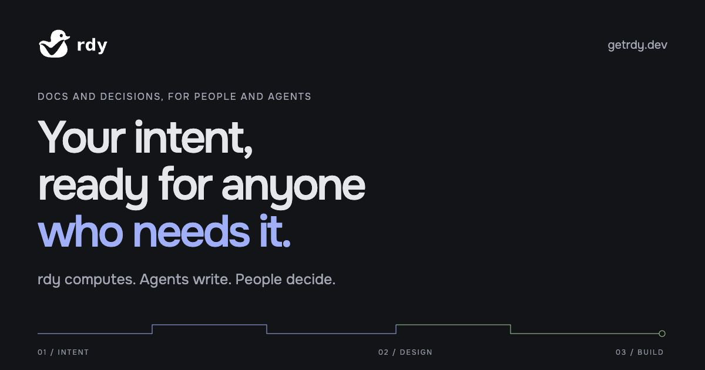
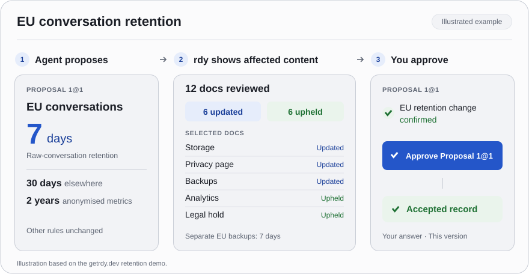

# rdy

**Your intent, ready for anyone who needs it.**

rdy stores what you intend and decided, and gives it to whoever needs it in a form they can use: a docs site for people, briefings and instructions for agents.

[](https://github.com/adrenickchrome/rdy-core/releases/latest) [](https://getrdy.dev/docs/) [](#license)

[Documentation](https://getrdy.dev/docs/latest/docs/) · [Install](#install) · [Try it](#try-it-your-first-project) · [Releases](https://github.com/adrenickchrome/rdy-core/releases) · [Report problems](#report-problems)

rdy keeps the compatibility promise of **Release 1** (rdy 0.47.0). See "About Release 1" at the bottom.

[](https://getrdy.dev/)

## How it works

- **Before an agent writes**, rdy shows it what governs the change and what depends on it.
- **After the write**, rdy shows what the change affected.
- **Nothing joins the accepted design** until a person approves it.

<picture>
  <source media="(prefers-color-scheme: dark)" srcset=".github/readme/review-loop-dark.svg">
  
</picture>

rdy computes. Agents write. People decide.

## What you get

- **Docs and decisions as one project.** Write docs, requirements, terms and decisions as linked blocks, not loose files.
- **Agents work through MCP.** Claude Code, or any MCP client, reads and writes through rdy's tools. Each agent gets a briefing before it edits.
- **Proposals and approvals.** Agent work lands in a view. You see the impact, then approve it or not.
- **It catches drift.** When a decision changes, rdy marks every page that rests on it. It also flags a page that states a different number for a recorded value.
- **A live docs site.** `rdy site` gives you a local site that refreshes as changes land.
- **Local and private.** Everything runs on your machine: no account, no hosted service, no model inside rdy.

## Install

Quick to install, low friction to start: one command, no account required. Free and open source.

**macOS (Apple silicon) and Linux (x86_64):**

```sh
curl -fsSL https://getrdy.dev/install.sh | sh
```

**Windows 11 (x64), in PowerShell:**

```powershell
irm https://getrdy.dev/install.ps1 | iex
```

Each installer checks the release signature and the archive's SHA-256 before it installs. It puts `rdy` in `~/.local/bin` for your user, and asks before it changes your PATH. You can read [install.sh](https://getrdy.dev/install.sh) and [install.ps1](https://getrdy.dev/install.ps1) first.

Open a new terminal, then check:

```sh
rdy --version
```

It prints `rdy 0.49.0`.

<details>
<summary>Install from the archive instead</summary>

**macOS (Apple silicon):**

```sh
curl -LO https://github.com/adrenickchrome/rdy-core/releases/download/v0.49.0/rdy-0.49.0-aarch64-apple-darwin.tar.gz
tar -xzf rdy-0.49.0-aarch64-apple-darwin.tar.gz
mkdir -p ~/.local/bin && mv rdy-0.49.0-aarch64-apple-darwin/rdy ~/.local/bin/
```

**Linux (x86_64):**

```sh
curl -LO https://github.com/adrenickchrome/rdy-core/releases/download/v0.49.0/rdy-0.49.0-x86_64-unknown-linux-gnu.tar.gz
tar -xzf rdy-0.49.0-x86_64-unknown-linux-gnu.tar.gz
mkdir -p ~/.local/bin && mv rdy-0.49.0-x86_64-unknown-linux-gnu/rdy ~/.local/bin/
```

**Windows (x86_64), in PowerShell:**

```powershell
Invoke-WebRequest -OutFile rdy-0.49.0-x86_64-pc-windows-msvc.tar.gz https://github.com/adrenickchrome/rdy-core/releases/download/v0.49.0/rdy-0.49.0-x86_64-pc-windows-msvc.tar.gz
tar.exe -xzf rdy-0.49.0-x86_64-pc-windows-msvc.tar.gz
New-Item -ItemType Directory -Force "$HOME\.local\bin" | Out-Null
Move-Item -Force rdy-0.49.0-x86_64-pc-windows-msvc\rdy.exe "$HOME\.local\bin\"
```

If `~/.local/bin` is not on your PATH, add it. On macOS, a binary from a browser download may be blocked: run `xattr -d com.apple.quarantine ~/.local/bin/rdy` once.

To check the signature yourself, see "Verify the download" at the bottom. You do not need it to use rdy.

</details>

## Try it: your first project

1. **Make a project.**

   ```sh
   rdy init ~/my-project && cd ~/my-project
   ```

2. **Connect your agent.** For Claude Code:

   ```sh
   claude mcp add rdy -- rdy mcp --project "$PWD"
   ```

   For another MCP client, add this server to its config, with the full project path:

   ```json
   { "mcpServers": { "rdy": { "command": "rdy", "args": ["mcp", "--project", "/home/you/my-project"] } } }
   ```

3. **Prepare your agent.**

   ```sh
   rdy setup
   ```

   This tells your agent, in `CLAUDE.md` and `AGENTS.md`, to load rdy's built-in guide at the start of each task. You download nothing.

4. **Ask your agent for something real.** For example:

   > Start an rdy session in your own view, then read its overview. Help me design retention for an AI support assistant. Our intent is to keep only the customer data we need, for as short a time as we can, and be able to explain the choices. Start with a decision to delete raw conversations after 30 days and keep anonymised metrics for 2 years. Create the storage docs and link them to the decision. Propose the first design for my approval.

5. **Review and approve it yourself.**

   ```sh
   rdy pending
   ```

   This shows what waits for you, with the impact of each proposal. Approve with `rdy approve P-<id>`, or tell your agent your answer.

6. **Read the result.**

   ```sh
   rdy site
   ```

   Open the link. Then change a decision and watch rdy follow the consequences. Ask your agent: “For EU customers, raw conversations must be deleted after 7 days. Keep the 30-day rule elsewhere and the 2-year metrics window.”

Next: [Make your first change](https://getrdy.dev/docs/latest/docs/guide/start-here/first-change) and [Build a useful design](https://getrdy.dev/docs/latest/docs/guide/start-here/build-a-design).

## Documentation

The docs for the latest release are at **[getrdy.dev/docs](https://getrdy.dev/docs/latest/docs/)**. [Each release](https://getrdy.dev/docs/) keeps its own edition.

| To | Read |
|---|---|
| Work with an agent, from a first project to a full design | [User guide](https://getrdy.dev/docs/latest/docs/guide/) |
| Learn blocks, views, briefings, decisions and tensions | [Concepts](https://getrdy.dev/docs/latest/docs/concepts/) |
| Look up a command, a tool or an error code | [CLI](https://getrdy.dev/docs/latest/docs/reference/cli) · [MCP tools](https://getrdy.dev/docs/latest/docs/reference/mcp-tools) · [Errors](https://getrdy.dev/docs/latest/docs/reference/errors) |
| See the store, the daemon, the config and the working copy | [How rdy is built](https://getrdy.dev/docs/latest/internals/) |
| Read what your agent reads | [Agent guide](https://getrdy.dev/docs/latest/agent-guide/) |

<details>
<summary><b>Upgrade from a preview, or build from source</b></summary>

rdy refuses a store from a different store format with E_STORE_FORMAT.
Before you replace the old binary, close its sessions and dump each project with that binary.
Stop the old project's daemon. Keep the original project and the old binary.
Use the new binary to load the dump into a directory with no store.
Check the loaded project with rdy fsck.

```bash
rdy dump --out <dump-file>             # old binary
rdy load <dump-file> <new-directory>   # new binary
```

Run the dump command in the old project. Run the load command with the new binary. In chat, your agent does the same with `rdy_dump` and `rdy_load`.

To build rdy from source (you need Rust):

```bash
git clone https://github.com/adrenickchrome/rdy-core.git
cd rdy-core
cargo install --path crates/rdy-cli
```

</details>

## License

rdy is available under either [MIT](LICENSE-MIT) or [Apache 2.0](LICENSE-APACHE), at your choice.

rdy's binaries also contain open-source libraries under their own licenses. Two of them, `imbl` and `imbl-sized-chunks`, use the [Mozilla Public License 2.0](https://www.mozilla.org/MPL/2.0/). Each release archive holds `THIRD-PARTY-NOTICES.txt` with every library's license. Each release also attaches the exact source code of the MPL-2.0 libraries.

## Report problems

Report problems at https://github.com/adrenickchrome/rdy-core/issues. Before 1.0, rdy takes issues, not pull requests.

<details>
<summary><b>About Release 1</b></summary>

Release 1 (rdy 0.47.0) is the first release of rdy with a compatibility promise.
rdy stays below 1.0 during the beta, and the promise holds anyway.

From this release on, a change that breaks a contract surface ships with its upgrade path, in the same release. The contract surfaces are:

- the store, dump, sync batch and working-copy formats, and signatures;
- the CLI's commands, arguments, flags, exit codes and `--json` output;
- the MCP tools: their names, parameters and result fields;
- the `E_*` and `W_*` codes;
- the config keys and the pack format;
- the Markdown export layouts and the site's URLs.

A renamed name keeps working, with a warning, for two minor releases and at least 30 days, whichever ends later.
Text for people, such as messages, fix texts and help, can change in any release. Match a code, never its text.
Content that the docs mark as planned is outside the promise.

Every later rdy reads every dump that this rdy writes.
If this rdy refuses the store of a project from a preview with `E_STORE_FORMAT`, move the project with dump and load.
Run `rdy dump --out <file>` with the old rdy. Then run `rdy load <file> <dir>` with this rdy, into a directory with no store.

Report problems at https://github.com/adrenickchrome/rdy-core/issues.

</details>

<details>
<summary><b>Verify the download (optional)</b></summary>

You do not need this to use rdy. It shows how to check that an archive is the one we signed, before you install it.

### Platforms

| Platform | Status |
|---|---|
| macOS (arm64) | Supported. The fast gate (`cargo qa --skip-perf --require-all`) passes. |
| Linux (x86_64, aarch64) | Supported. The fast gate passes on x86_64; aarch64 builds and runs its tests (one timing-bound test is being fixed). Perf baselines are Linux only. |
| Windows (x86_64) | Supported on Windows 11. Each release ships a native `x86_64-pc-windows-msvc` archive. |
| Other Unix (the BSDs, illumos) | Untested. |

### Archives

Each release has three archives: macOS arm64, Windows amd64 and Linux amd64. The Linux archive is qualified on Ubuntu 26.

| Platform | Target | Archive |
|---|---|---|
| macOS arm64 | `aarch64-apple-darwin` | [rdy-0.49.0-aarch64-apple-darwin.tar.gz](https://github.com/adrenickchrome/rdy-core/releases/download/v0.49.0/rdy-0.49.0-aarch64-apple-darwin.tar.gz) |
| Windows amd64 | `x86_64-pc-windows-msvc` | [rdy-0.49.0-x86_64-pc-windows-msvc.tar.gz](https://github.com/adrenickchrome/rdy-core/releases/download/v0.49.0/rdy-0.49.0-x86_64-pc-windows-msvc.tar.gz) |
| Linux amd64 | `x86_64-unknown-linux-gnu` | [rdy-0.49.0-x86_64-unknown-linux-gnu.tar.gz](https://github.com/adrenickchrome/rdy-core/releases/download/v0.49.0/rdy-0.49.0-x86_64-unknown-linux-gnu.tar.gz) |

The release is [v0.49.0](https://github.com/adrenickchrome/rdy-core/releases/tag/v0.49.0). It also holds [SHA256SUMS](https://github.com/adrenickchrome/rdy-core/releases/download/v0.49.0/SHA256SUMS) and [SHA256SUMS.sig](https://github.com/adrenickchrome/rdy-core/releases/download/v0.49.0/SHA256SUMS.sig).

Download the archive for your platform, SHA256SUMS and SHA256SUMS.sig into one new directory.
Check the signature with OpenSSH, then check the archive hash, before extraction or execution. The signed file is SHA256SUMS.
This signature is not Apple notarization.

### Release signing key

```text
rdy-release namespaces="rdy-release-v1" ssh-ed25519 AAAAC3NzaC1lZDI1NTE5AAAAIIUyk+U70yjuD/Ixg86ti9BBo0Kc/NL0ps3KAOAIVC/8
```

Fingerprint: SHA256:Tj8hfra0U07asaeSZkt1b5e1HGJ+w8vMzLrn+G6/+/M.

Compare this line and fingerprint with the ones in the [GitHub release notes](https://github.com/adrenickchrome/rdy-core/releases/tag/v0.49.0). Use the key only when both match.

### Release keys

Each version has exactly one release key. A signature by any other key is refused.

| Versions | Key type | Fingerprint | State |
| --- | --- | --- | --- |
| v0.17.0 to v0.41.0 | `sk-ssh-ed25519@openssh.com` | `SHA256:Baa52ZPJSzazbmd2KDEkzUM6OYTnl8mznJXsmnwvvJc` | historical key, retired for new releases |
| v0.46.0 and later | `ssh-ed25519` | `SHA256:Tj8hfra0U07asaeSZkt1b5e1HGJ+w8vMzLrn+G6/+/M` | machine key, current |

No other version has a release key.

The allowed-signers line for v0.17.0 to v0.41.0:

```text
rdy-release namespaces="rdy-release-v1" sk-ssh-ed25519@openssh.com AAAAGnNrLXNzaC1lZDI1NTE5QG9wZW5zc2guY29tAAAAIDiiQ0vO3dvG2AtbJYDwsshJl75kvbbnRDOCUdsjfrDRAAAAD3NzaDpyZHktcmVsZWFzZQ==
```

The allowed-signers line for v0.46.0 and later:

```text
rdy-release namespaces="rdy-release-v1" ssh-ed25519 AAAAC3NzaC1lZDI1NTE5AAAAIIUyk+U70yjuD/Ixg86ti9BBo0Kc/NL0ps3KAOAIVC/8
```

#### transition-v0.46.0.json

The historical root key signed this transition in namespace `rdy-release-signer-transition-v1`. Its exact bytes:

```json
{
  "fingerprint": "SHA256:Tj8hfra0U07asaeSZkt1b5e1HGJ+w8vMzLrn+G6/+/M",
  "first_machine_tag": "v0.46.0",
  "public_key": "ssh-ed25519 AAAAC3NzaC1lZDI1NTE5AAAAIIUyk+U70yjuD/Ixg86ti9BBo0Kc/NL0ps3KAOAIVC/8",
  "repository": "adrenickchrome/rdy-core",
  "scheme": "rdy-release-signer-transition-v1"
}
```

Its signature, `transition-v0.46.0.json.sig`:

```text
-----BEGIN SSH SIGNATURE-----
U1NIU0lHAAAAAQAAAFUAAAAac2stc3NoLWVkMjU1MTlAb3BlbnNzaC5jb20AAAAgOKJDS8
7d28bYC1slgPCyyEmXvmS9tudEM4JR2yN+sNEAAAAPc3NoOnJkeS1yZWxlYXNlAAAAIHJk
eS1yZWxlYXNlLXNpZ25lci10cmFuc2l0aW9uLXYxAAAAAAAAAAZzaGE1MTIAAABnAAAAGn
NrLXNzaC1lZDI1NTE5QG9wZW5zc2guY29tAAAAQAAMJ6vc+kjRRGIqsc/eNBCVeMVBwQbV
rE1wK+eqPHThAHWqcVvepXDtUU25Myumq05ptb7Iddo4+sJR0a2r0A4FAAAAFQ==
-----END SSH SIGNATURE-----
```

Verify it offline with the root key:

```sh
cd '/path/to/release-keys' &&
'printf' '%s\n' 'rdy-release namespaces="rdy-release-signer-transition-v1" sk-ssh-ed25519@openssh.com AAAAGnNrLXNzaC1lZDI1NTE5QG9wZW5zc2guY29tAAAAIDiiQ0vO3dvG2AtbJYDwsshJl75kvbbnRDOCUdsjfrDRAAAAD3NzaDpyZHktcmVsZWFzZQ==' > '/path/to/release-keys/root-transition-allowed-signers' &&
'ssh-keygen' '-Y' 'verify' '-f' 'root-transition-allowed-signers' '-I' 'rdy-release' '-n' 'rdy-release-signer-transition-v1' '-s' 'transition-v0.46.0.json.sig' < '/path/to/release-keys/transition-v0.46.0.json'
```

### Install

On macOS arm64, for an archive downloaded with curl:

```sh
cd '/path/to/download' &&
'printf' '%s\n' 'rdy-release namespaces="rdy-release-v1" ssh-ed25519 AAAAC3NzaC1lZDI1NTE5AAAAIIUyk+U70yjuD/Ixg86ti9BBo0Kc/NL0ps3KAOAIVC/8' > '/path/to/download/release-allowed-signers' &&
'ssh-keygen' '-Y' 'verify' '-f' 'release-allowed-signers' '-I' 'rdy-release' '-n' 'rdy-release-v1' '-s' 'SHA256SUMS.sig' < '/path/to/download/SHA256SUMS' &&
'shasum' '-a' '256' '-c' '--ignore-missing' 'SHA256SUMS' &&
'mkdir' '/path/to/unpack' '/path/to/rdy-0.49.0' &&
'tar' '-xzf' '/path/to/download/rdy-0.49.0-aarch64-apple-darwin.tar.gz' '-C' '/path/to/unpack' &&
'mkdir' '-p' '/path/to/rdy-0.49.0/bin' &&
'install' '-m' '755' '/path/to/unpack/rdy-0.49.0-aarch64-apple-darwin/rdy' '/path/to/rdy-0.49.0/bin/rdy' &&
'/path/to/rdy-0.49.0/bin/rdy' '--version'
```

On Linux amd64:

```sh
cd '/path/to/download' &&
'printf' '%s\n' 'rdy-release namespaces="rdy-release-v1" ssh-ed25519 AAAAC3NzaC1lZDI1NTE5AAAAIIUyk+U70yjuD/Ixg86ti9BBo0Kc/NL0ps3KAOAIVC/8' > '/path/to/download/release-allowed-signers' &&
'ssh-keygen' '-Y' 'verify' '-f' 'release-allowed-signers' '-I' 'rdy-release' '-n' 'rdy-release-v1' '-s' 'SHA256SUMS.sig' < '/path/to/download/SHA256SUMS' &&
'sha256sum' '-c' '--ignore-missing' 'SHA256SUMS' &&
'mkdir' '/path/to/unpack' '/path/to/rdy-0.49.0' &&
'tar' '-xzf' '/path/to/download/rdy-0.49.0-x86_64-unknown-linux-gnu.tar.gz' '-C' '/path/to/unpack' &&
'mkdir' '-p' '/path/to/rdy-0.49.0/bin' &&
'install' '-m' '755' '/path/to/unpack/rdy-0.49.0-x86_64-unknown-linux-gnu/rdy' '/path/to/rdy-0.49.0/bin/rdy' &&
'/path/to/rdy-0.49.0/bin/rdy' '--version'
```

On Windows amd64, in PowerShell:

```powershell
& {
$ErrorActionPreference = 'Stop'
Set-Location -LiteralPath 'C:\path\to\download'
$s = [IO.File]::Open('C:\path\to\download\release-allowed-signers', [IO.FileMode]::OpenOrCreate, [IO.FileAccess]::Write, [IO.FileShare]'ReadWrite, Delete'); $s.SetLength(0); $b = [Text.Encoding]::UTF8.GetBytes('rdy-release namespaces="rdy-release-v1" ssh-ed25519 AAAAC3NzaC1lZDI1NTE5AAAAIIUyk+U70yjuD/Ixg86ti9BBo0Kc/NL0ps3KAOAIVC/8' + [char]10); $s.Write($b, 0, $b.Length); $s.Close()
& 'cmd.exe' '/d' '/c' 'ssh-keygen.exe -Y verify -f release-allowed-signers -I rdy-release -n rdy-release-v1 -s SHA256SUMS.sig < SHA256SUMS'
if ($LASTEXITCODE -ne 0) { throw 'a step failed' }
$n = 0; foreach ($line in [IO.File]::ReadAllLines('C:\path\to\download\SHA256SUMS')) { $want = $line.Substring(0, 64); $name = $line.Substring(66); $file = [IO.Path]::Combine('C:\path\to\download', $name); if (Test-Path -LiteralPath $file) { $got = (Get-FileHash -LiteralPath $file -Algorithm SHA256).Hash.ToLower(); if ($got -cne $want) { throw ($name + ': FAILED') }; [Console]::Out.Write($name + ': OK' + [char]10); $n++ } }; if ($n -eq 0) { throw 'no archive was checked' }
foreach ($dir in @('C:\path\to\unpack', 'C:\path\to\rdy-0.49.0')) { if (Test-Path -LiteralPath $dir) { throw ($dir + ' exists') }; [void][IO.Directory]::CreateDirectory($dir) }
& (Join-Path $env:SystemRoot 'System32\tar.exe') '-xzf' 'C:\path\to\download\rdy-0.49.0-x86_64-pc-windows-msvc.tar.gz' '-C' 'C:\path\to\unpack'
if ($LASTEXITCODE -ne 0) { throw 'a step failed' }
[void][IO.Directory]::CreateDirectory('C:\path\to\rdy-0.49.0\bin')
[IO.File]::Copy('C:\path\to\unpack\rdy-0.49.0-x86_64-pc-windows-msvc\rdy.exe', 'C:\path\to\rdy-0.49.0\bin\rdy.exe')
& 'C:\path\to\rdy-0.49.0\bin\rdy.exe' '--version'
if ($LASTEXITCODE -ne 0) { throw 'a step failed' }
}
# Add the version's bin directory to PATH in this session:
# $env:Path = 'C:\path\to\rdy-0.49.0\bin;' + $env:Path
# rdy needs SSH_AUTH_SOCK, even when ssh works without it. Set it to the agent pipe:
# $env:SSH_AUTH_SOCK = '\\.\pipe\openssh-ssh-agent'
```

On macOS arm64, for an archive downloaded with a web browser:

```sh
# In Safari, turn off “Open safe files after downloading” before downloading. Keep the original .tar.gz file.
# After both checks pass, remove com.apple.quarantine from the archive before extraction. Skip this command if the archive has no com.apple.quarantine attribute.
cd '/path/to/download' &&
'printf' '%s\n' 'rdy-release namespaces="rdy-release-v1" ssh-ed25519 AAAAC3NzaC1lZDI1NTE5AAAAIIUyk+U70yjuD/Ixg86ti9BBo0Kc/NL0ps3KAOAIVC/8' > '/path/to/download/release-allowed-signers' &&
'ssh-keygen' '-Y' 'verify' '-f' 'release-allowed-signers' '-I' 'rdy-release' '-n' 'rdy-release-v1' '-s' 'SHA256SUMS.sig' < '/path/to/download/SHA256SUMS' &&
'shasum' '-a' '256' '-c' '--ignore-missing' 'SHA256SUMS' &&
'xattr' '-d' 'com.apple.quarantine' '/path/to/download/rdy-0.49.0-aarch64-apple-darwin.tar.gz' &&
'mkdir' '/path/to/unpack' '/path/to/rdy-0.49.0' &&
'tar' '-xzf' '/path/to/download/rdy-0.49.0-aarch64-apple-darwin.tar.gz' '-C' '/path/to/unpack' &&
'mkdir' '-p' '/path/to/rdy-0.49.0/bin' &&
'install' '-m' '755' '/path/to/unpack/rdy-0.49.0-aarch64-apple-darwin/rdy' '/path/to/rdy-0.49.0/bin/rdy' &&
'/path/to/rdy-0.49.0/bin/rdy' '--version'
```

Add the version's bin directory to PATH in this shell.
Replace `<version-prefix>` with the version prefix, such as `/path/to/rdy-0.49.0`:

```sh
export PATH="<version-prefix>/bin:$PATH"
```

</details>
